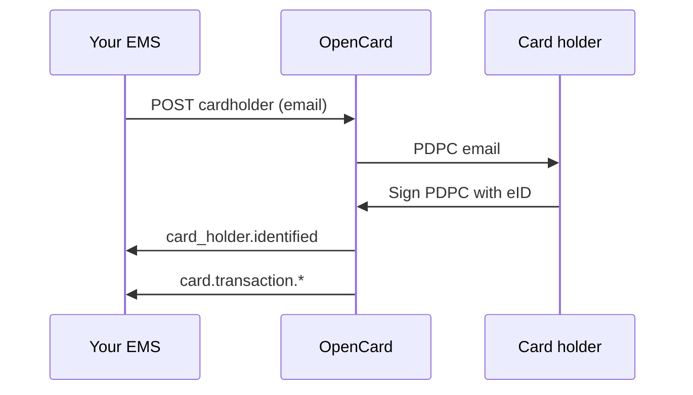

A **card holder** = one person in one organization whose card transactions you want in your EMS.

Create the card holder with an email. OpenCard sends a PDPC link, the person signs with eID, and transactions start when identification completes.

<Tip>
  Card holders come **after** client setup (billing, TPA, organization, webhook). See the [full onboarding flow](/ems/customer-onboarding) if you have not finished Phase 1 yet.
</Tip>



<Note>
  Client already receives transactions from the issuer another way? See [Current card issuer integration](/ems/current-card-issuer-integration).
</Note>

---

## Create

Use this for every employee whose card spend should appear in your EMS.

```
POST /accounts/{accountId}/organizations/{organizationId}/cardholders
Scope: card-holders-write
```

```json
{
  "reference_id": "employee_john_42",
  "email": "john@acme.se",
  "language": "sv"
}
```

| Field | Required | Notes |
|-------|----------|-------|
| `reference_id` | ✅ | Your internal user ID. Unique within the organization |
| `email` | ✅ | Where the PDPC signing link is sent |
| `language` | ❌ | PDPC legal text: `sv`, `no`, `da`, `en`, `fi` |
| `skip_pdpc_email` | ❌ | Default `false` — email is sent |

### What happens

1. Card holder + PDPC record created
2. 📧 **Email queued** — subject: `We need your approval.`
3. Link: `https://{env}/accounts/{accountId}/pdpcs/{pdpcId}/sign/{token}`
4. User reads PDPC → checks consent → identifies with **eID**
5. On eID success → identity linked → `card_holder.identified` webhook
6. **Retroactive transactions** dispatched (everything since last card invoice)
7. New transactions flow in real time

### Timeline

```
You:     POST cardholder ─────────────────────────────────────────►
User:              receives email ──► signs PDPC/eID ──►
OpenCard:                                    identified ──► txs flow ⚡
```

<Tip>
  Subscribe to `card_holder.identified` — that's your signal that transactions are coming (including a retroactive batch). Don't wait for `card_holder.signed.pdpc` alone; identification is what unlocks the pipe.
</Tip>

Full eID details → [eID Signing](/ems/eid-signing)

---

## Webhooks to handle

| Event | When |
|-------|------|
| `card_holder.created` | On create |
| `card_holder.identified` | After eID sign — transactions start, including the retroactive batch |
| `card_holder.signed.pdpc` | After eID sign |
| `card.transaction.*` | After identified |

**Your integration should key off `card_holder.identified`** as the moment transactions are expected.

---

## Update / delete

```
GET    .../cardholders                    ← list (includes identity name + employee_id)
PUT    .../cardholders/{cardHolderId}     ← update reference_id and/or email
DELETE .../cardholders/{cardHolderId}    ← fires card_holder.deleted
Scope: card-holders-write (PUT), card-holders-delete (DELETE)
```

### Update

`reference_id` is **required**. `email` is **optional** — omit it to keep the current value.

**Change reference ID only** (no PDPC email if already identified / no email on record):

```json
PUT .../cardholders/15
{ "reference_id": "employee_john_99" }
```

**Change reference ID and email** (may resend PDPC email — see below):

```json
{
  "reference_id": "employee_john_42",
  "email": "john.newemail@acme.se",
  "skip_pdpc_email": false,
  "language": "sv"
}
```

| Field | Required | Notes |
|-------|----------|-------|
| `reference_id` | ✅ | Your internal user ID |
| `email` | ❌ | Only sent when you want to change it |
| `skip_pdpc_email` | ❌ | Default unchanged if omitted |
| `language` | ❌ | PDPC mail language if a resend is triggered |

PDPC email is resent only when **all** of: PDPC unsigned or no `identity_id`, `skip_pdpc_email` is false, and the card holder has an email address.

`reference_id` must be unique within the organization. Duplicate → `400 Bad Request` with message `Card holder reference … already exists` (same as create).

---

## List card holders

```
GET /accounts/{accountId}/organizations/{organizationId}/cardholders
Scope: card-holders-read
```

Supports filters `q`, `reference_id`, `where_ssn_set`, `where_signed_pdpc`, `where_email_delivered`.

**Response (per item):**

```json
{
  "id": 15,
  "reference_id": "employee_john_42",
  "organization_id": 3,
  "identity_id": 123,
  "email": "john@acme.se",
  "created_at": "2026-06-08T10:00:00.000000Z",
  "updated_at": "2026-06-08T10:30:00.000000Z",
  "meta": {
    "ssn": true,
    "signed": true,
    "signed_at": "2026-06-08T10:30:00.000000Z",
    "email_status": "delivered",
    "pdpc_url": "https://api.opencard.io/accounts/1/pdpcs/8/sign/abc...",
    "system": "Acme EMS",
    "organization_number": "5561234567"
  },
  "identity": {
    "name": "Anna Andersson",
    "employee_id": "001"
  }
}
```

| Field | What it tells you |
|-------|-------------------|
| `identity_id` | OpenCard identity ID when linked (null before eID sign) |
| `identity.name` | Person name from eID — use for display in your UI |
| `identity.employee_id` | Employee ID on the TPA client (if set on `client_identity`) |
| `identity` | `null` when not yet linked to an identity |

<Tip>
  Names for a card holder list come from this endpoint — read `identity`. You do not need a separate `GET .../tpas/{tpaId}/identities` call for that.
</Tip>

---

## `meta` in API responses

Check consent status without polling webhooks:

```json
{
  "id": 7,
  "reference_id": "employee_john_42",
  "meta": {
    "ssn": true,
    "signed": true,
    "signed_at": "2026-06-08T10:30:00Z",
    "email_status": "delivered",
    "pdpc_url": "https://api.opencard.io/accounts/1/pdpcs/3/sign/abc...",
    "system": "Acme EMS",
    "organization_number": "5561234567"
  },
  "identity": {
    "name": "John Doe",
    "employee_id": "042"
  }
}
```
